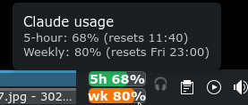

# Claude Usage (KDE Plasma 6 widget)



A panel widget that shows Claude's 5-hour and weekly usage as two stacked bars
(`5h` on top, `wk` below). The bars turn green, then yellow at 70%, then red at 90%.
Hover for exact percentages and reset times. Click to open a popup with details;
opening it also refreshes the numbers. It polls every 60 seconds.

## How it works

- `contents/code/fetch.py` reads the Claude Code OAuth token from
  `~/.claude/.credentials.json`, calls `https://api.anthropic.com/api/oauth/usage`
  (with header `anthropic-beta: oauth-2025-04-20`), and prints compact JSON:
  `{"five": {"pct", "resets"}, "week": {...}}` or `{"error": "..."}`.
  `resets` is in Unix epoch seconds.
- `contents/ui/main.qml` runs the script through the Plasma5Support `executable`
  data source on a timer.

## Caveats

- **Undocumented endpoint.** It's the one behind Claude Code's `/usage` command,
  and it could change or break without notice. The response also has many other
  fields; we only use `five_hour` and `seven_day` (`utilization`, `resets_at`).
- **Token expiry.** The access token expires every few hours. The widget
  deliberately does *not* refresh it, since that would mean rewriting a file
  Claude Code manages. Claude Code refreshes it whenever you use it. Until then
  the widget shows `!` and the tooltip says "Token expired".

## Install / update

```sh
kpackagetool6 -t Plasma/Applet -i .   # first install
kpackagetool6 -t Plasma/Applet -u .   # after changes
kquitapp6 plasmashell && kstart plasmashell   # reload so the panel picks it up
```

Test outside the panel with `plasmawindowed org.pvint.claudeusage`.
QML errors and `console.log` output go to plasmashell's stderr; in a normal
session that's `~/.local/share/sddm/wayland-session.log`.

## Gotchas hit while building

- **Missing `fullRepresentation`.** Without one, Plasma never created the
  compact (panel) representation, so the widget was invisible but still
  right-clickable.
- **Panel padding.** Panels pad applets top and bottom (a 40px panel gave
  24px). `Plasmoid.constraintHints: Plasmoid.CanFillArea` lets the widget use
  the full panel height.
- **Removing a widget from a script:**
  `qdbus6 org.kde.plasmashell /PlasmaShell org.kde.PlasmaShell.evaluateScript '<js>'`
  with `panels()[i].widgets("org.pvint.claudeusage")[j].remove()`.

## Ideas not done

- A marker showing how far you are into the 5-hour window, for pacing.
- Config UI (poll interval, thresholds, labels).
- The response's `seven_day_breakdown` gives per-product shares (Claude Code /
  Chats / Cowork) that could go in the popup.
